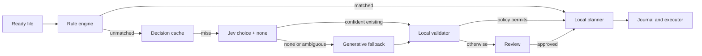

# Hybrid AI Architecture

## Invariants

1. Deterministic rules always run before AI.
2. Provider output never contains executable filesystem authority.
3. Providers see opaque destination IDs, not paths or bookmark data.
4. Local validation, policy, preview, journaling, and execution remain separate stages.
5. New folders and generative fallbacks require review in Stage 2 v1.
6. Automatic existing-folder moves require an explicit user policy and a benchmark-approved exact model version.

## Flow

`HybridDecisionOrchestrator` owns branching only. It has no dependency on folder bookmarks, `FileManager`, or the operation executor. `DestinationDecisionProvider` handles closed-set decisions; `GenerativeAIProvider` handles folder proposals and natural-language rules.

## BYOK

BYOK classification requires a TypeSafe Jev key plus OpenAI, Gemini, DeepSeek, or Ollama configuration. Keys live in Keychain. A Jev outage queues review unless the user explicitly enables failover. Requests go directly from the Mac to the configured services.

## Mochi Pro

The Pro gateway implements the same typed contracts. Its model registry chooses only benchmark-approved exact model versions. Authentication, billing, entitlements, quotas, orchestration, and provider secrets remain server-side. The client still performs final validation and all filesystem operations.

## Result handling

- Jev existing destination: validate ID, confidence, probability margin, model approval, and source fingerprint.
- Jev `none_of_these`: invoke the configured generative fallback.
- Generative existing destination: always review in v1 because the route is an uncertainty escalation.
- Proposed folder: validate one safe relative component and require review.
- Clarification, no recommendation, and provider errors never move a file.

## Model upgrades

Rolling aliases are never trusted for automatic operations. Every response records the resolved model version. A new version begins review-only and receives new calibration thresholds only after the frozen benchmark holdout passes.
